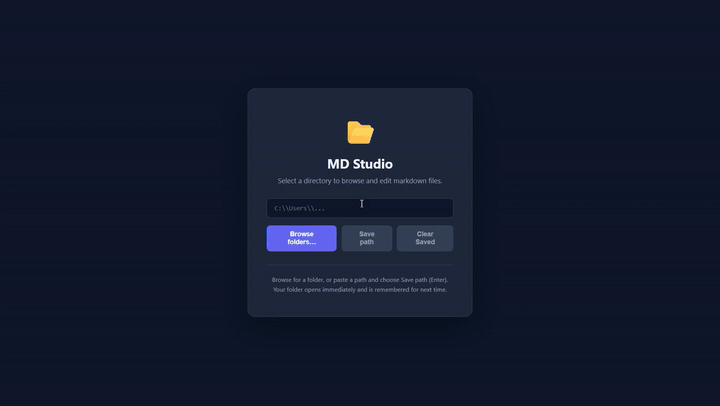
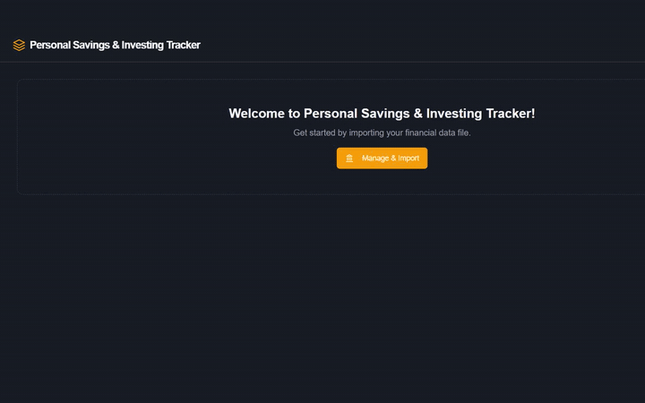

## 002 · Markdown Studio

Expand this to read more...

**Summary**

**Edit local Markdown with source and live preview side by side.** Markdown Studio brings a folder of notes or documentation into a local browser workspace. Choose a folder with the Windows picker, open an existing Markdown file or create a new one, and see headings, lists, tables, quotations and code blocks take shape as you write. Save changes directly to the original file with Save or Ctrl+S.

Switch between Edit, Preview and Split views to focus on writing or inspect the rendered document. In Split view, scrolling either pane moves the other by relative position; turn Sync off when you want to browse them independently. The app remembers your workspace folder between launches, while your documents stay in their original location.

<video width="100%" controls autoplay loop muted playsinline preload="none" poster="Images_GIFs_Videos/002_MD_Studio.gif" aria-label="Markdown Studio recording"><source src="Images_GIFs_Videos/002_MD_Studio.mp4" type="video/mp4"></video>

[Watch the MP4](Images_GIFs_Videos/002_MD_Studio.mp4) · [App instructions and source](https://github.com/EdRey05/Nodejs_projects/tree/main/002_MD_Studio) · [Synthetic sample](demo-data/002/Notebook.md)

**How to use it**

1. Extract the Windows portable folder and double-click Start.cmd.
2. Use Browse folders to choose your Markdown folder in the Windows dialog, or paste a path and choose Save path. The folder opens immediately and is remembered for next time.
3. Open a .md file. Edit source on the left and inspect the live preview on the right.
4. Click Save or press Ctrl+S. Use Stop.cmd when finished.

**In the demo**

select the examples folder with the real Windows picker, edit an existing notebook, then create a longer document with headings, bold, italics, underlining, bullet and numbered lists, checkboxes, quotations, tables and code blocks. Scroll through the synchronized panes, save and reopen the actual file. Underlining and crossed-out text use supported inline HTML. The recording uses the packaged app in an offline sandbox, with pauses trimmed and folder navigation accelerated. Preview HTML is sanitized; external images and links may still need internet. Closing the browser tab does not stop the background app.

[Edited notebook](demo-data/002/Notebook-edited.md) · [Long Markdown example](demo-data/002/Markdown-showcase.md)

---

## 001 · Personal Savings & Investing Tracker

Expand this to read more...

**Summary**

**Explore savings and investment records from an Excel workbook.** The Personal Savings & Investing Tracker brings savings, managed investments and self-directed portfolios into separate dashboards. Open a local workbook, review account balances and transaction history, and add or edit activity without moving your records to a cloud service. Changes save back to the selected file automatically, and the app reopens it on the next launch. Export creates a separate copy when needed.

Use historical charts to explore recorded activity, or adjust contributions, growth assumptions and duration to compare simple projection scenarios. For self-directed accounts, inspect cash movements, trades, recorded income and allocation by holding or asset category. Balances combine cash with remaining holdings at average cost; charts do not retrieve live prices or unrealized gains.

<video width="100%" controls autoplay loop muted playsinline preload="none" poster="Images_GIFs_Videos/001_S_I.gif" aria-label="Finance tracker recording"><source src="Images_GIFs_Videos/001_S_I.mp4" type="video/mp4"></video>

[Watch the MP4](Images_GIFs_Videos/001_S_I.mp4) · [App instructions and workbook format](https://github.com/EdRey05/Nodejs_projects/tree/main/001_S_I) · [Synthetic portfolio](demo-data/001/Synthetic_Portfolio.xlsx)

**How to use it**

1. Extract the Windows portable folder and double-click Start.cmd.
2. In Manage & Import, choose Open workbook and select a local .xlsx file (use a copy of the synthetic sample when experimenting).
3. Select an account, inspect transactions/charts and add entries.
4. Wait for Saved; edits go back to the selected file, which reopens on the next launch. Export downloads a separate copy. Temporary imports still require Export. Use Stop.cmd when finished.

**In the demo**

The walkthrough uses a fictional portfolio to show how to open a workbook, update account activity and explore the savings, managed-investment and self-directed dashboards. It demonstrates historical charts, growth projections and portfolio allocation using the actual packaged app in an offline sandbox. Only file-browser navigation is accelerated.

Balances and projections use recorded activity and simplified calculations, without live market prices. No AI or cloud account is used.

[Sample details and expected balances](demo-data/README.md)

