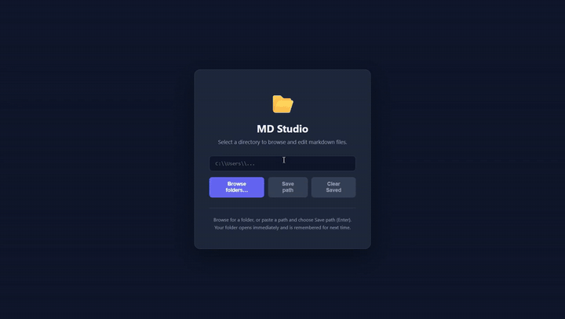
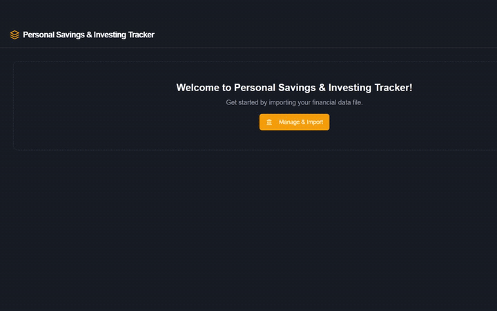

## 002 · Markdown Studio

Expand this to read more...

**Summary**

**Edit local Markdown with source and live preview side by side.** Choose a folder, select or create a Markdown file, edit it in Split view and save directly to the original file.

<video width="100%" controls autoplay loop muted playsinline preload="none" poster="Images_GIFs_Videos/002_MD_Studio.gif" aria-label="Markdown Studio recording"><source src="Images_GIFs_Videos/002_MD_Studio.mp4" type="video/mp4"></video>

[Watch the MP4](Images_GIFs_Videos/002_MD_Studio.mp4) · [App instructions and source](https://github.com/EdRey05/Nodejs_projects/tree/main/002_MD_Studio) · [Synthetic sample](demo-data/002/Notebook.md)

**How to use it**

1. Extract the Windows portable folder and double-click Start.cmd.
2. Use Browse folders to choose your Markdown folder in the Windows dialog, or paste a path and choose Save path. The folder opens immediately and is remembered for next time.
3. Open a .md file. Edit source on the left and inspect the live preview on the right.
4. Click Save or press Ctrl+S. Use Stop.cmd when finished.

**In the demo**

select the examples folder with the real Windows picker, edit an existing notebook, then create a longer document with headings, bold, italics, underlining, bullet and numbered lists, checkboxes, quotations, tables and code blocks. Scroll through the synchronized panes, save and reopen the actual file. Underlining and crossed-out text use supported inline HTML. The recording uses the packaged app in an offline sandbox, with pauses trimmed and folder navigation accelerated. Preview HTML is sanitized; external images and links may still need internet. Closing the browser tab does not stop the background app.

[Edited notebook](demo-data/002/Notebook-edited.md) · [Long Markdown example](demo-data/002/Markdown-showcase.md)

---

## 001 · Personal Savings & Investing Tracker

Expand this to read more...

**Summary**

**Explore savings and investment records from an Excel workbook.** Open a local workbook, inspect charts and edit accounts/transactions with automatic saving and reopening of the previous file. Export remains available for separate copies. The Windows portable v1.0.0 includes savings, managed and self-directed dashboards.

<video width="100%" controls autoplay loop muted playsinline preload="none" poster="Images_GIFs_Videos/001_S_I.gif" aria-label="Finance tracker recording"><source src="Images_GIFs_Videos/001_S_I.mp4" type="video/mp4"></video>

[Watch the MP4](Images_GIFs_Videos/001_S_I.mp4) · [App instructions and workbook format](https://github.com/EdRey05/Nodejs_projects/tree/main/001_S_I) · [Synthetic portfolio](demo-data/001/Synthetic_Portfolio.xlsx)

**How to use it**

1. Extract the Windows portable folder and double-click Start.cmd.
2. In Manage & Import, choose Open workbook and select a local .xlsx file (use a copy of the synthetic sample when experimenting).
3. Select an account, inspect transactions/charts and add entries.
4. Wait for Saved; edits go back to the selected file, which reopens on the next launch. Export downloads a separate copy. Temporary imports still require Export. Use Stop.cmd when finished.

**In the demo**

use the Windows file picker to open a fictional portfolio with 451 transactions across three accounts. Add a $100 savings contribution, inspect historical growth and set a projection to $250 per month at 5% for 20 years. Explore managed investing, then self-directed holdings/income allocation, growth projections, cash movements, transaction history and six asset-performance charts. File-browser navigation is accelerated; the dashboard actions and pauses retain their original speed. All footage shows the actual packaged app in an offline sandbox.

Self-directed balances include cash plus holdings at average cost. Contributions and withdrawals move money between your pocket and the account; purchases use cash, while sales and income stay in cash until reinvested or withdrawn. Allocation charts and simplified projections do not use live market prices. No AI or cloud account is used.

[Sample details and expected balances](demo-data/README.md)

